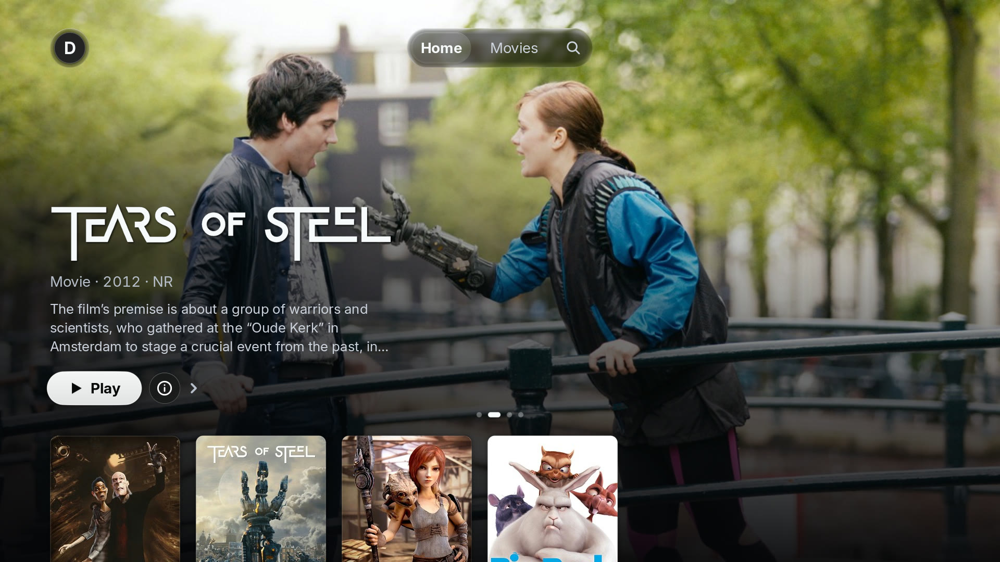
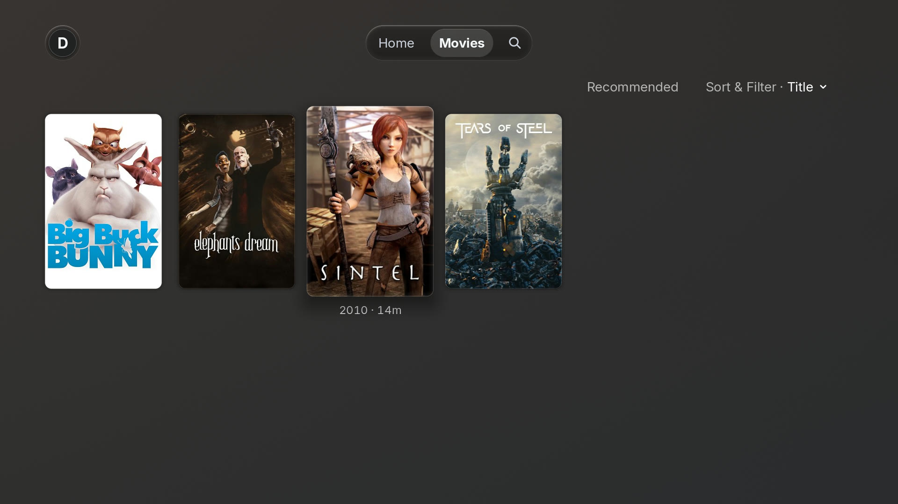
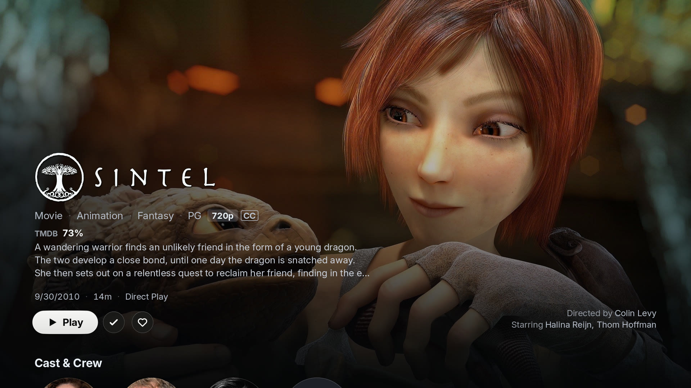
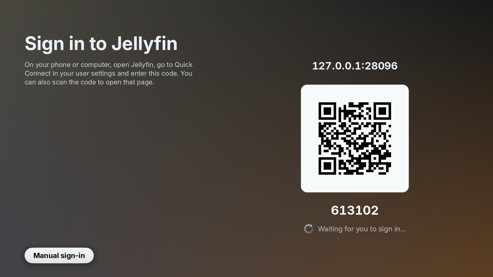

# FinNative

An unofficial, native [Jellyfin](https://jellyfin.org/) client for LG webOS televisions.

FinNative is powered by **[PlxNative](https://github.com/GLinnik21/plx-native)**, the fast native Plex
client written by **Gleb Linnik**. Everything that makes it fast is his work: the interface drawn
straight on the GPU with SDL2 and OpenGL ES, the FFmpeg demuxer feeding the TV's own hardware
decoder through LG's media pipeline, the layout, widgets, player and storage layers. FinNative adds
a Jellyfin backend to that engine and ships it as a separate app. If you use Plex, use PlxNative.

> **Status: early.** 0.1.0 is FinNative's first release. It has been developed and tested on one
> television (an LG C1) against one Jellyfin server, so expect rough edges, and please
> [say how it went](https://github.com/tiper/fin-native/issues) on yours.

## Screenshots

  
  

  
  

Captured in FinNative's desktop simulator against a Jellyfin server holding only the open films
credited under [Credit](#credit), so every title and image is free to show. The simulator
draws the same interface as the television but plays no video, so there is no player screenshot.

## What works

- **Sign-in** with Quick Connect from your phone, or with the server's address, a username and a
  password. Jellyfin servers on your home network are found for you.
- **Your movie and TV libraries**, as your server shows them: Home follows your Jellyfin home
  screen, and libraries, collections, seasons, episodes and people each have a page. A library can
  be filtered by genre.
- **Search** across films, shows and people.
- **Several Jellyfin users** on one TV, on one server or several: add one with **Add user** and
  switch with **Change profile**.
- **Playback** with the television's own decoders. FinNative tells your server what the TV can
  decode, and the server decides whether the file plays directly or is converted, within the limits
  its administrator set. Audio the TV can't decode can be converted on the TV itself.
- **The parts of watching you expect:** resume where you stopped, the next episode, Skip Intro and
  Skip Credits where the server knows them, scrub thumbnails, your audio and subtitle preferences,
  subtitle search through the server, and favourites. Watch progress is kept by your server.

## What doesn't work yet

- **Music, photos and live TV** aren't supported.
- **Playlists.** They are listed but can't be opened yet; collections work.
- **Controlling the TV from the Jellyfin phone app.** The TV doesn't show up there as a player.
- **Seeking and resuming through Cloudflare.** On a server behind Cloudflare, seeking or resuming
  a file can fail.
- **Items that need server transcoding** fail with "Playback failed" when your server can't or
  isn't allowed to transcode. That is the server's limit, not a FinNative bug.

## Will it work on my television?

**It needs webOS 4.0 or newer.** Only an LG C1 (2021, webOS 6) has played video with FinNative so
far. Every firmware from webOS 4.0 up is expected to start it, because each release checks its
libraries and symbols against the firmware images webosbrew collects; that says nothing yet about
whether video plays. webOS 3.9.2 and older can't start it.

### Known issues

FinNative shares PlxNative's player, so it shares the problems PlxNative has documented on
particular sets:

| Where | What happens |
|---|---|
| **Some 2019 sets on LG's k5lp or k3lp chip**, installed through Developer Mode | Video won't play. LG's Developer Mode sandbox on these sets can withhold a device the video path needs. The app checks for it and says so instead of crashing. On a rooted TV with Homebrew Channel, the failure screen offers **Repair** ([what it does](docs/native-video-sandbox.md)); without root there is no fix. |
| **Sets on LG's k6hp chip** | PlxNative has a crash report from these sets that hasn't been reproduced: [GLinnik21/plx-native#174](https://github.com/GLinnik21/plx-native/issues/174). |

[Troubleshooting](docs/troubleshooting-finnative.md) covers the rest. If your set isn't an LG C1, a report
that it works is as useful as one that it doesn't.

## Installing

**No root is needed.** You install FinNative with LG's Developer Mode and
[webOS Dev Manager](https://github.com/webosbrew/dev-manager-desktop) on a computer:

1. Turn on Developer Mode on the TV and connect Dev Manager to it.
2. Download `io.github.tiper.finnative_X.Y.Z_arm.ipk` from the
   [latest release](https://github.com/tiper/fin-native/releases/latest) and check its hash.
3. Install it from Dev Manager's **Apps** view, then open **FinNative** on the TV and sign in.

The [installation guide](docs/install-finnative.md) walks through every step, including the
Developer Mode session you must renew or LG removes the apps it installed. FinNative isn't in the
Homebrew Channel catalogue yet.

## Credit

- **PlxNative** — Copyright (c) 2026 Gleb Linnik and contributors, GPL-3.0-or-later.
  Upstream: <https://github.com/GLinnik21/plx-native>. The upstream README is kept as
  [`README.plxnative.md`](README.plxnative.md), its links to the user guides pointed at upstream's, and its full history is preserved in this
  repository.
- **FinNative's changes** (the Jellyfin layer in `rust-modules/jellyfin/`, the backend hook in
  `rust-modules/plex/src/plex/backend.rs`, and the renaming) — Copyright (c) 2026 FinNative's
  maintainer ([@tiper](https://github.com/tiper)), under the same GPL-3.0-or-later terms.
- **Other Jellyfin clients for LG webOS** that FinNative takes code or designs from, each credited
  in the source file that uses it: [Native Jelly](https://github.com/sostk/native-jelly) by sostk
  and [Butaca](https://github.com/gnacho/butaca) by gnacho, both forks of PlxNative under
  GPL-3.0-or-later, and [WebOS-Jellyfin-Native](https://github.com/SchulzCode/WebOS-Jellyfin-Native)
  by SchulzCode (0BSD).
- Third-party components keep their own licences: see
  [`THIRD-PARTY-NOTICES.md`](THIRD-PARTY-NOTICES.md).
- **The films in the screenshots** are Blender Foundation open movies, licensed
  [CC BY 3.0](https://creativecommons.org/licenses/by/3.0/): *Big Buck Bunny* (c) 2008 Blender
  Foundation | peach.blender.org, *Elephants Dream* (c) 2006 Blender Foundation | orange.blender.org,
  *Sintel* (c) 2010 Blender Foundation | durian.blender.org and *Tears of Steel* (c) 2012 Blender
  Foundation | mango.blender.org. Their posters and stills are the films' own artwork.

FinNative is not endorsed by the PlxNative project. Please report FinNative problems
[here](https://github.com/tiper/fin-native/issues), not upstream.

## A separate app, not a replacement

FinNative installs **beside** PlxNative and never over it:

| | PlxNative | FinNative |
|---|---|---|
| App id | `com.beb.plxnative` | `io.github.tiper.finnative` |
| Name on the TV | PlxNative | FinNative |
| Icon and splash | PLX artwork (reserved by its author) | its own FinNative artwork |
| Stored data | `plxstate.*` records | `finstate.*` records |
| Server | Plex | Jellyfin |

PlxNative's name and artwork are reserved by its author (see [`TRADEMARKS.md`](TRADEMARKS.md)), so
FinNative carries its own. The name PlxNative appears in this app only to credit the work it is
built on.

## Privacy

FinNative sends no crash reports or analytics. It talks only to the Jellyfin server you sign in
to, and while you sign in it looks for Jellyfin servers on your home network. Your password is
never stored. [`PRIVACY.md`](PRIVACY.md) is the full policy, and the same text is in the app under
Settings → Legal.

## Building

The build, simulator and TV workflows are PlxNative's, unchanged; see
[`docs/building.md`](docs/building.md) and [`docs/agent-reference.md`](docs/agent-reference.md).
The default `FLAVOR=debug` package installs as `io.github.tiper.finnative.debug`.

## Licence

GPL-3.0-or-later, the same as PlxNative. [`LICENSE`](LICENSE) is the unmodified GPLv3 text and
[`LICENSING.md`](LICENSING.md) states the "or later" choice.

Jellyfin is a project of the Jellyfin team; Plex is a trademark of Plex, Inc.; LG and webOS are
trademarks of LG Electronics. FinNative is not affiliated with or endorsed by any of them.
